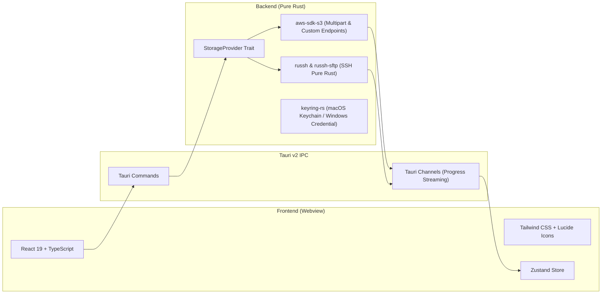

# Orbit 🛸

[](https://github.com/matryt/Orbit/actions/workflows/ci.yml)
[](https://github.com/matryt/Orbit/releases)
[](LICENSE)
[](https://tauri.app)
[](https://react.dev)
[](https://www.rust-lang.org)

**Orbit** is a modern, lightweight, blazing-fast SFTP (and soon S3) desktop client inspired by **Transmit**, **Linear**, and **Raycast**. Built with Tauri v2, pure Rust, and React, Orbit is engineered to replace legacy tools like Cyberduck and FileZilla with a sleek, minimalist, and developer-friendly experience.

---

## ✨ Features

- ⚡ **Pure Rust Engine**: Powered by `tokio` and `russh`. High-performance streaming transfers without loading files into RAM.
- 🔑 **Modern SFTP**: Pure Rust SFTP client with password and SSH Key authentication (`ed25519`, `rsa`, `id_ecdsa`).
- 🪣 **Universal S3 Support** *(Coming in v0.2)*: Architecture prepared for AWS S3, Cloudflare R2, Scaleway, MinIO with custom endpoint URLs and multipart uploads. *(v0.1 is 100% focused on rock-solid SFTP)*.
- 🔒 **Native OS Keyring Security**: Credentials, passwords, and SSH passphrases are encrypted and stored directly in your operating system's native secure store (macOS Keychain or Windows Credential Manager). Never plain text.
- 🪟 **Native macOS & Windows Experience**:
  - **macOS**: Native window vibrancy (translucent sidebar), hidden title bar overlay, and smooth gestures.
  - **Windows**: Sleek frameless dark window with integrated titlebar controls.
- 👁️ **Quick Look (`Space`)**: Instant preview for source code, JSON, YAML, Markdown, server logs, and images without downloading them locally.
- 📂 **Flexible Explorer Layout**:
  - Single-pane remote browser by default.
  - Dual-pane (**Local | Remote**) view toggled instantly via the toolbar or `Cmd/Ctrl + B`.
  - Search filter (`Cmd/Ctrl + F`) and clickable breadcrumb navigation.
- 🏷️ **File Metadata & Permissions**: View permissions, owners, and groups (`owner:group`), size, and modification timestamps.
- 📦 **Connection Profiles Management**: Save, edit, reconnect, or export/import connection profiles as clean JSON (with secrets safely kept in the OS keychain) to easily share configurations.

---

## 📥 Installation

Download the latest release for your platform from the [GitHub Releases](https://github.com/matryt/Orbit/releases) page.

### macOS (Apple Silicon ARM64)

1. Download `Orbit_x.x.x_aarch64.dmg`.
2. Open the DMG and drag **Orbit** to your `/Applications` folder.
3. **First launch (Gatekeeper)**: Because Orbit is currently built without a paid Apple Developer certificate, macOS may show an *"unidentified developer"* prompt. Run the following command once in your terminal to allow it:

```bash
xattr -cr /Applications/Orbit.app
```

> [!NOTE]
> **Intel Mac (`x86_64`)**: Official prebuilt packages target Apple Silicon (ARM64) natively. If you are using an Intel Mac, you can easily build Orbit from source:
> ```bash
> git clone https://github.com/matryt/Orbit.git && cd Orbit
> npm install && npm run tauri build
> ```
> The compiled application will be generated in `src-tauri/target/release/bundle/dmg/`.

### Windows (10 / 11)

1. Download the Windows installer (`Orbit_x.x.x_x64-setup.exe` or `.msi`).
2. Run the installer and launch Orbit from the Start menu.

---

## 🛠️ Architecture & Tech Stack



- **Frontend**: Tauri v2, React 19, TypeScript, Vite, Tailwind CSS, Lucide Icons, Zustand.
- **Backend**: Rust 2024 edition, Tokio async runtime, `aws-sdk-s3`, `russh` / `russh-sftp`, `keyring-rs`, `window-vibrancy`.

---

## 💻 Local Development

### Prerequisites

- [Node.js](https://nodejs.org/) v22+
- [Rust](https://www.rust-lang.org/tools/install) (stable toolchain)
- **Linux** (if developing on Linux): `libwebkit2gtk-4.1-dev`, `libayatana-appindicator3-dev`, `libsecret-1-dev`

### Setup

```bash
# Clone the repository
git clone https://github.com/matryt/Orbit.git
cd Orbit

# Install frontend dependencies
npm ci

# Run development server with Tauri desktop window
npm run tauri dev
```

### Testing & Linting

```bash
# Type check and build frontend
npm run build

# Check Rust formatting and lints
cd src-tauri
cargo fmt --all -- --check
cargo clippy -- -D warnings
cargo test
```

### Docker (Headless CI Verification)

You can also run all validation checks locally in an isolated Linux container:

```bash
docker build -t orbit-ci .
```

---

## 🎯 Project Philosophy & Roadmap

Orbit is developed as an open-source project to solve the daily frustration of slow, outdated FTP/S3 clients.

- **Zero Feature Creep**: Orbit focuses strictly on being fast, beautiful, and rock-solid for S3 and SFTP. We intentionally avoid obscure legacy protocols (FTP over telnet, WebDAV, etc.).
- **Pull Requests Welcome**: Contributions that fix bugs, improve performance, or refine UX are warmly welcomed! Please open an issue first to discuss substantial additions.

### Roadmap & Upcoming Features
- [x] High-performance pure Rust SFTP streaming engine (v0.1)
- [x] Remote file operations: New folder, inline rename, delete with confirmation (v0.1)
- [x] Secure credentials management via native OS Keyring (v0.1)
- [x] Quick Look instant preview and dual-pane browsing (v0.1)
- [ ] **Universal S3 Provider** (AWS S3, Cloudflare R2, Scaleway, MinIO) *(v0.2)*
- [ ] Native drag-and-drop file transfers from OS desktop/explorer
- [ ] Recursive directory upload and download
- [ ] Remote file permissions editor (`chmod`)
- [ ] "Edit in external editor" with automatic upload on save
- [ ] SSH Agent support (`ssh-agent` / Pageant)

---

## 📄 License

Distributed under the **MIT License**. See `LICENSE` for more information.
